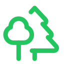

<!-- Aletheia: public homepage and repository entry point. The logo follows Lucide's Trees icon (ISC licence). -->
<p align="center"></p>

<h1 align="center">ALETHEIA</h1>
<h3 align="center">The World Tree of Knowledge</h3>

<p align="center"><em>One tree to link them all.<br>Many minds to question them.<br>And truth to illuminate them.</em></p>

<p align="center"><strong>Rooted in knowledge. Branching into possibilities.</strong></p>

<p align="center">Visit the Worldwide AI site: <a href="https://karstenevans.github.io/aletheia/">Aletheia</a></p>

---

## What is Aletheia?

Aletheia, the Worldwide AI site, is a free, human-centred and AI-independent gateway to connected knowledge, research, learning, useful applications, articles and open protocols.

The name comes from the Greek word for **truth**, often associated in philosophy with disclosure or bringing what is hidden into the light. Our visual identity borrows from **Yggdrasil**, the World Tree of Norse mythology: a single tree whose branches connect many different worlds.

Here those worlds are projects. **The tree connects them; it does not control them.** Each project remains independently useful, and different AI systems and people are welcome to examine and question the evidence.

Expect curiosity, practical tools, a little mythology, and humour where it helps rather than distracts.

## Explore the branches

| Branch | Purpose | Destination |
| --- | --- | --- |
| **Aletheia Apps** | Small, usable, evidence-aware browser and portable Markdown applications. | [Aletheia Apps project](https://karstenevans.github.io/aletheia-app/) |
| **Aletheia Knowledge** | Evidence-linked collections, local knowledge and learning resources. | [Aletheia Knowledge project](https://karstenevans.github.io/aletheia-knowledge/) |
| **Aletheia Protocol** | Portable records of evidence, uncertainty, decisions and handovers. | [Aletheia Protocol repository](https://github.com/KarstenEvans/aletheia-protocol) |
| **Thalia Protocol** | A complementary open approach to understanding and creating humour. | [Thalia Protocol repository](https://github.com/KarstenEvans/thalia-protocol) |
| **Aletheia Learn** | Accessible courses on AI and practical reasoning. | [Aletheia Learn App](https://karstenevans.github.io/aletheia-app/aletheia-learn/aletheia-learn.htm) |
| **Aletheia Go** | Explorations, scientific ideas and original thought-provoking articles. | [Aletheia Go project](https://karstenevans.github.io/aletheia/aletheia-go/) |
| **Articles** | Humour, science and curiosity, including *The Big Hug Theory*. | [Aletheia Articles](https://karstenevans.github.io/aletheia/articles/) |

**Aletheia Go** and **Articles** now have their own folder landing pages and published HTML manuscripts. Some additional courses and article formats remain in development. This hub is an index and front door, not a replacement for the individual repositories.

## Join the community

**[Aletheia Discussions: Leave a Dot](https://github.com/KarstenEvans/aletheia/discussions)** welcomes ideas, criticism, original humour keys, writer vibes, research references and app feedback. Please read the [Code of Conduct](CODE_OF_CONDUCT.md) and [Discussion guide](DISCUSSIONS.md). Visitors can suggest improvements; maintainers retain control of source files.

## Our principles

- **Knowledge belongs to the project, not the assistant.**
- Facts, hypotheses, satire and uncertainty should be distinguishable.
- Link to original sources where practical, and correct mistakes openly.
- Stay portable, affordable and useful without dependence on one AI vendor.
- Put human usefulness first, and keep the site accessible and mobile friendly.
- Let imagination attract attention; let evidence earn trust.

## GUI and naming guidance

The public name of this hub is **Aletheia, the Worldwide AI site**. **The World Tree of Knowledge** remains its visual subtitle. Future editors and AI agents should read [aletheia-GUI.md](aletheia-GUI.md) before changing the public identity, homepage or navigation.

## Worldwide AI site structure

```text
index.html               Public homepage of the Worldwide AI site (GitHub Pages)
README.md                Human + AI-readable repository introduction
assets/world-tree.svg    Green two-tree logo
aletheia-go/index.html    Go Walkabout research landing page
articles/index.html       Humour and science article landing page
CODE_OF_CONDUCT.md        Community conduct rules
DISCUSSIONS.md            Discussion categories and welcome template
```

The Worldwide AI site is intentionally small and static. The richer applications and knowledge collections remain in their own repositories. This hub uses ordinary HTML and CSS; it does not require server hosting, paid APIs or GitHub Actions.

### Publishing

In **Settings → Pages**, choose **Deploy from a branch**, then **main** and **/(root)**. Click **Save**. The intended published URL is:

https://karstenevans.github.io/aletheia/

An index page becomes public only after GitHub Pages is successfully configured and deployed.

## Provenance and acknowledgements

The site is a hub, not an official academic institution, an independent certifier, or a guarantee that linked content is correct. Check primary sources and revisions.

Aletheia is inspired by Greek philosophy, Norse mythology and the playful tradition of fantasy, without claiming affiliation with the authors or franchises mentioned in its commentary.

The two-tree line icon is adapted from [Lucide](https://lucide.dev/icons/trees) (ISC license). All external projects retain their own licensing and governance.

**One tree to link them all. Many minds to question them. And truth to illuminate them.**
