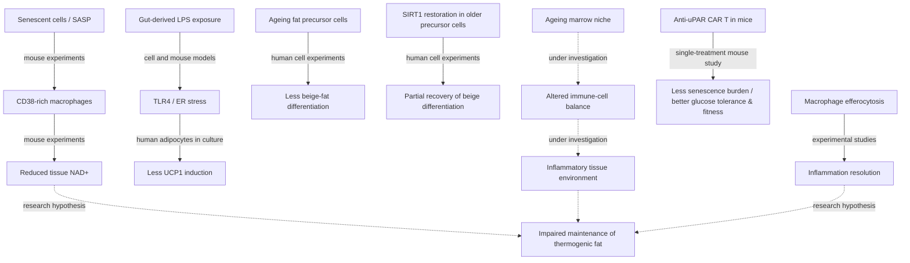

# AletheiaGo 001 — Evidence map

**Aletheia Protocol:** https://github.com/KarstenEvans/aletheia-protocol  
**Thalia Protocol:** https://github.com/KarstenEvans/thalia-protocol/blob/main/THALIA_PROTOCOL.md

## Mechanism diagram for GitHub

**Reading key:** solid arrows = evidence for a component mechanism in experimental systems; dotted arrows = **hypothesised link requiring tests**. The overall figure is **not** a quantified graph or a proven unified pathway.

## One real human age comparison (not a continuous ageing curve)

**Yoneshiro et al., 2011, n=162:** Detectable cold-activated brown fat under the study's imaging protocol was **greater than 50% among participants in their twenties**, but **less than 10% among participants in their fifties and sixties**. These are bounded proportions from the original abstract, **not** invented exact rates. Source: https://pubmed.ncbi.nlm.nih.gov/21566561/

## Safety against accidental overclaiming

- Red-to-yellow marrow conversion is mostly developmental; red marrow persists in adults. Yellow marrow has active functions.
- Senescence can protect against uncontrolled cell division; not all senescent cells are harmful.
- Not all white fat becomes beige, and beige fat does not normally mature into classical brown fat.
- CD38 expression and NAD+ regulation vary by tissue and immune-cell type.
- FGF21 commonly increases with age; age-related hormone resistance is not universal.
- Canagliflozin and CAR-T results about senescence are mouse experiments, not proven human anti-ageing treatments.
- This map is a source of **hypotheses**, not a claim of causality among all arrows.
